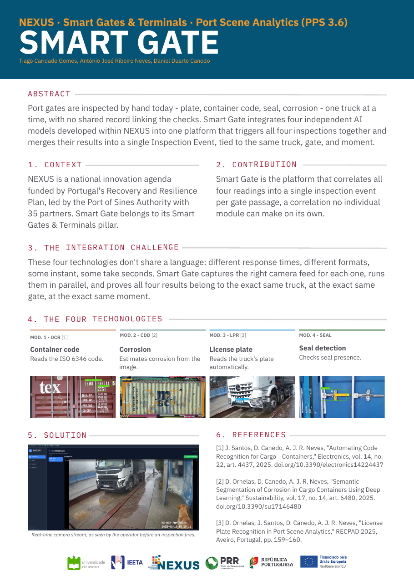

# NEXUS – PPS 3.6 Port Scene Analytics

**Smart Gates & Smart Terminals** · Work Package 3.6 of the NEXUS Innovation Pact · IEETA, University of Aveiro

This organization holds the Smart Gate demonstrator: a platform that inspects containers at port gates by combining four computer vision modules developed at IEETA. For each inspection it captures one frame per camera, sends it to the modules assigned to that camera, and merges the results (license plate, container code, corrosion and security seal) into a single inspection event with alerts, shown live in a web interface.

## Repositories

| Repository | Description |
|---|---|
| [nexus_smart-gate](https://github.com/NEXUS-PPS-3-6/nexus_smart-gate) | Smart Gate platform: orchestrator, web interface and the Docker Compose deployment of the whole system. Start here. |
| [nexus_LPR](https://github.com/NEXUS-PPS-3-6/nexus_LPR) | License plate recognition service |
| [nexus_CDD](https://github.com/NEXUS-PPS-3-6/nexus_CDD) | Corrosion detection service |
| [nexus_container_code_ocr](https://github.com/NEXUS-PPS-3-6/nexus_container_code_ocr) | Container code (ISO 6346) recognition service |
| [nexus_seal_detection](https://github.com/NEXUS-PPS-3-6/nexus_seal_detection) | Security seal detection service |

Clone the five repositories into the same folder, copy the model weights (provided separately) into each module, and follow the [Smart Gate README](https://github.com/NEXUS-PPS-3-6/nexus_smart-gate#readme) to run everything with `docker compose up`.

## Poster

Presented at the European Researchers' Night, Aveiro, 25 September 2026 ([PDF](https://github.com/NEXUS-PPS-3-6/.github/raw/main/profile/assets/smart_gate_poster_ERN_2026.pdf)).

## Authorship

The Smart Gate platform, the integration of the modules and the seal detection service were developed by **Tiago Caridade Gomes**, supervised by António José Ribeiro Neves and Daniel Duarte Canedo. The license plate, corrosion, container code and seal detection models were developed by the IEETA team; each repository states its authors.

## Funding

Developed within the NEXUS Innovation Pact – Green and Digital Transition for Transport, Logistics and Mobility, funded by the Recovery and Resilience Plan (PRR) and the NextGenerationEU European Funds.
